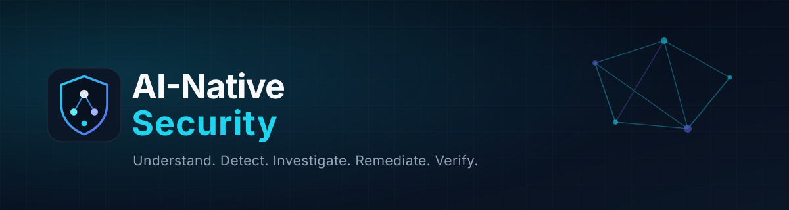
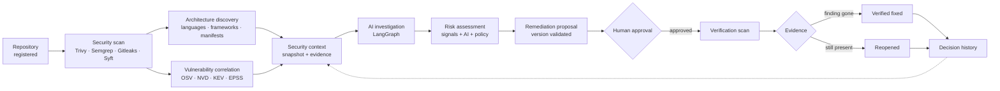
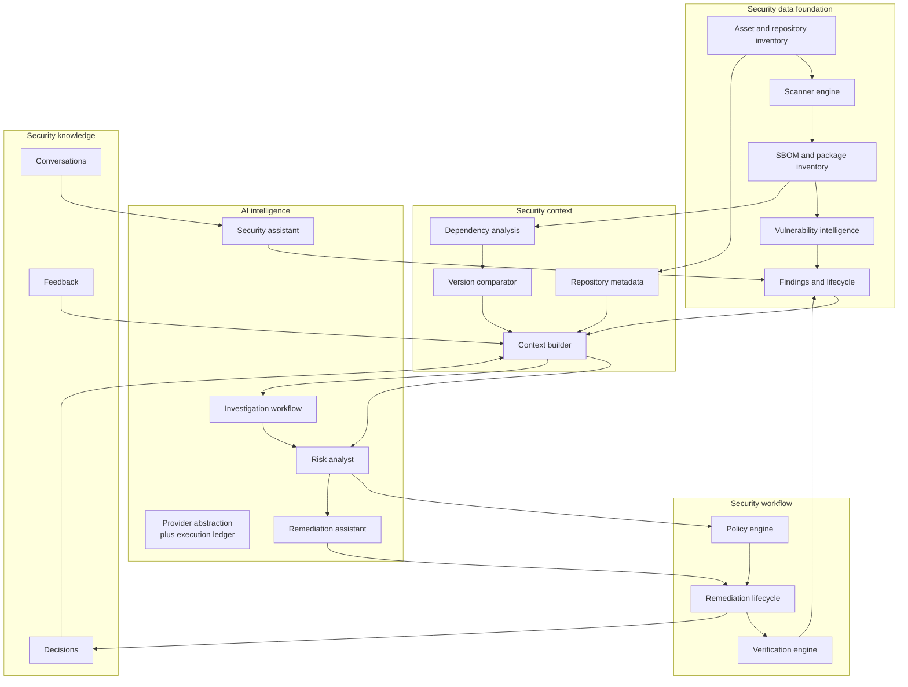
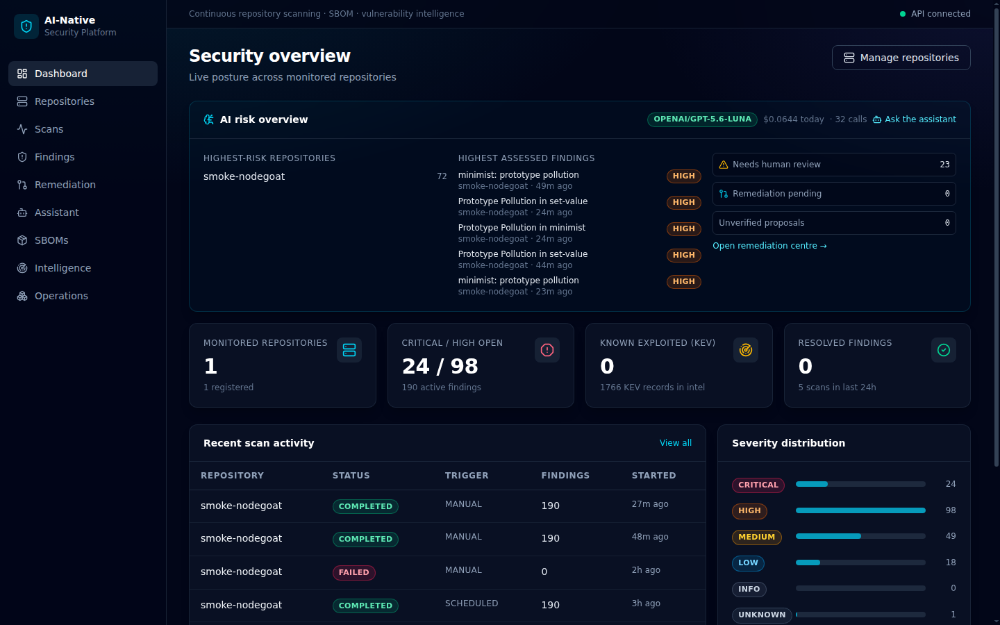

<p align="center">
  <picture>
    <source media="(prefers-color-scheme: light)" srcset="docs/assets/banner-light.svg">
    
  </picture>
</p>

<h1 align="center">AI-Native Security</h1>

<p align="center">
  <strong>Understand. Detect. Investigate. Remediate. Verify.</strong><br>
  A self-hosted security platform that understands your application, investigates real risk,
  and proves whether a fix actually worked.
</p>

<p align="center">
  
  
  
  
  
  
  
</p>

<p align="center">
  <a href="#quick-start">Quick start</a> ·
  <a href="#architecture">Architecture</a> ·
  <a href="docs/AI_ARCHITECTURE.md">AI architecture</a> ·
  <a href="#security-philosophy">Security philosophy</a> ·
  <a href="#roadmap">Roadmap</a> ·
  <a href="CONTRIBUTING.md">Contributing</a>
</p>

---

A traditional scanner answers one question: *which versions in this repository have
known CVEs?* That answer is necessary and almost never sufficient. It does not tell you
whether the vulnerable code is reachable, whether the service is exposed, which team
owns it, what a safe upgrade looks like for this codebase, or whether the upgrade that
was merged actually removed the risk.

AI-Native Security closes that loop. It inventories repositories, runs real scanners,
correlates findings with OSV, NVD, CISA KEV and EPSS, assembles the **context** around
each finding, and then uses an LLM for what LLMs are good at — reading evidence,
explaining impact, planning an investigation, proposing a fix — while scanners, version
arithmetic, policy and re-scans remain the only authority on what is true.

> **AI proposes. Evidence disposes.**

## What it does

| Stage | What happens | Who decides |
| --- | --- | --- |
| **Understand** | Repositories, languages, frameworks, manifests, dependency inventory and business context (criticality, exposure, environment, owner) | Deterministic collectors |
| **Detect** | Trivy, Semgrep, Gitleaks and Syft run in an isolated worker; findings are normalized and deduplicated by semantic fingerprint | Scanner binaries |
| **Correlate** | OSV matches the exact installed version; NVD, CISA KEV and EPSS enrich severity and exploit likelihood | Deterministic code |
| **Investigate** | A LangGraph workflow feeds a versioned security context to an LLM and produces an evidence-cited report | AI, with citations |
| **Prioritise** | Eight deterministic signals and an AI judgement are blended by a versioned policy — CVSS, deterministic, AI, final and confidence are stored separately | Policy + evidence |
| **Remediate** | The model proposes a strategy and optionally a patch; every proposed version is re-checked against authoritative fixed-version data | AI proposes, code validates |
| **Verify** | A human approves, a new scan runs, and the platform compares versions and findings before/after — including new risk introduced by the fix | Scan evidence only |
| **Learn** | Decisions, feedback and outcomes are stored and retrievable for the next investigation | Humans |

## Why AI-Native Security?

**Application awareness, not just package names.**
Languages, frameworks and manifest inventory are derived from real scans, and findings
with a source location keep a bounded, redacted snippet. When the question is "where
does this enter the application?", the answer comes from your repository rather than
from a CVE description.

**Contextual vulnerability analysis.**
Every finding expands into a security context: what was detected, which package or file,
how it enters the dependency tree (when the SBOM provides a graph), what the advisory
says, whether it is in KEV, what EPSS observes, and what the business context is. Missing
inputs are reported as missing — never filled in.

**Evidence-grounded AI, with citations.**
The model may only cite evidence keys (`E1`, `E2`, …) that the platform supplied.
Citations it invents are discarded, and an impact claim with no surviving citation is
downgraded to manual review. Output is validated against a strict schema; a malformed
answer fails closed instead of being stored.

**Prioritisation you can audit.**
CVSS is one signal, not the answer. Eight weighted signals (CVSS, KEV, EPSS, exploit
references, dependency directness, internet exposure, asset criticality, fix availability)
produce a deterministic score; the AI contributes a contextual opinion; a versioned
policy blends them. Any score can be re-derived later from the stored signals plus the
policy version.

**Remediation proposals that cannot invent a version.**
A recommended version must appear in authoritative `fixed_versions` **and** pass the
per-ecosystem version comparator. If the model suggests a version that does not satisfy
the range, the rejection is recorded rather than shipped. Nothing is written to a
repository.

**Verification by evidence, not by assertion.**
After approval a real scan runs. The verification engine compares the package versions
observed before and after, whether the finding survived, and whether the change introduced
new high/critical findings. "Verified fixed" means the scanner agrees — not that the model
said so.

**Self-hosted by design.**
One FastAPI application, one worker, one scheduler, PostgreSQL, a React dashboard and
Docker Compose. No hosted control plane, no vendor telemetry. The model provider is
configurable, including a self-hosted OpenAI-compatible endpoint, and with AI disabled
every deterministic capability still works.

## How it works



The dotted edge is the feedback loop: recorded decisions and outcomes are available to
later investigations as prior knowledge.

## Architecture



Layers 1–2 and 4–5 are deterministic Python; only layer 3 calls a model. The execution
ledger records every model call — model, prompt version, tokens, cost, latency, error —
so the AI layer can be audited independently of its output.

Deeper detail: [`docs/ARCHITECTURE.md`](docs/ARCHITECTURE.md) (pipeline and module
boundaries), [`docs/AI_ARCHITECTURE.md`](docs/AI_ARCHITECTURE.md) (lifecycles and
guardrails), [`docs/ERD.md`](docs/ERD.md) (data model).

## Features

Status reflects the code in this repository, not intentions. `IMPLEMENTED` means it runs
and is covered by tests; `PARTIAL` names exactly what is missing; `PLANNED` means it does
not exist yet.

| Capability | What you get | Status |
| --- | --- | --- |
| **Asset inventory** | GitHub/GitLab repositories, private access with encrypted tokens, monitoring, per-asset scan cadence, manual scans | `IMPLEMENTED` |
| **Business context** | Criticality, environment, internet exposure, business importance, data sensitivity, owner — stored and consumed by risk scoring | `IMPLEMENTED` (API; no editing form in the UI yet) |
| **Security scanning** | Trivy, Semgrep, Gitleaks in an isolated worker: argv-only execution, rlimits, timeouts, per-scanner status and output excerpts | `IMPLEMENTED` |
| **SBOM management** | Syft CycloneDX/SPDX generation, artifact storage, package inventory, download | `IMPLEMENTED` |
| **Dependency graph** | SBOM edge extraction, parent lookup, direct/transitive analysis, depth from a root dependency | `PARTIAL` — parser, storage and analysis exist, but the bundled Syft build emits no `dependencies` for directory scans, so most repositories report `dependency_graph_unavailable` |
| **Vulnerability intelligence** | OSV (exact installed version), NVD incremental sync, CISA KEV, daily EPSS, source attribution, sync history | `IMPLEMENTED` |
| **Finding management** | Normalization, semantic fingerprints, deduplication, history, status transitions, auto-resolution only after a clean scan | `IMPLEMENTED` |
| **Security context engine** | Finding, repository, dependency, vulnerability, business and history sections; redacted evidence; explicit missing-information; reproducible `evidence_hash` | `IMPLEMENTED` |
| **AI risk analysis** | Deterministic signals plus AI judgement blended by a versioned policy; CVSS, deterministic, AI, final and confidence stored separately | `IMPLEMENTED` |
| **AI investigation** | LangGraph workflow, evidence-key citations, five bounded statuses, a labelled deterministic-only fallback when the model fails | `IMPLEMENTED` |
| **AI remediation** | Strategy, reasoning, optional patch proposal, breaking-change risks, tests to run; every version validated against authoritative data | `IMPLEMENTED` (proposals only — nothing is applied) |
| **Approval workflow** | `DISCOVERED → … → AWAITING_APPROVAL → APPROVED → VALIDATING → VERIFIED → DEPLOYED → CLOSED`, plus rejection and reopening; decisions recorded with actor and reason | `IMPLEMENTED` |
| **Verification engine** | Re-scan diff: version before/after, finding survival, new high/critical findings, policy gate; status derived only from scanner evidence | `IMPLEMENTED` |
| **Deployment verification** | Confirming that a fix reached a running environment | `PLANNED` |
| **Security assistant** | Natural-language questions over ten read-only typed tools, asset-scoped, every tool call logged and every finding cited | `IMPLEMENTED` |
| **Feedback capture** | Storage and service layer for rating assessments and remediations | `PARTIAL` — no API endpoint or UI control yet |
| **Policy engine** | Versioned risk, remediation and data-sharing policies applied at runtime and recorded on each assessment | `PARTIAL` — read/apply implemented; authoring a new version is still code or SQL work |
| **Knowledge retrieval** | Decision history, similar-rule history, remediation success history, transcript search | `IMPLEMENTED` |
| **Application architecture mapping** | Call graphs, symbol-level reachability, cross-file taint analysis | `PLANNED` |
| **Runtime security intelligence** | Live telemetry, RASP, traffic evidence | `PLANNED` |
| **Pull-request automation** | Opening fix PRs | `PLANNED` |

## Screenshots

<p align="center">
  
</p>

| Screen | What it shows |
| --- | --- |
| [AI analysis on a finding](docs/screenshots/findings-ai-panel.png) | Five separate risk numbers, the weighted signal table, and the model's reasoning for one finding |
| [Remediation centre](docs/screenshots/remediation-center.png) | Proposals with validated versions, lifecycle status and verification outcome |
| [Security assistant](docs/screenshots/assistant.png) | A grounded answer with the tool calls it made, the findings it cited, and the gaps it admits |

Screenshots are captured from the running application. The capture procedure and the
shots still missing (investigation report, SBOM view) are listed in
[`docs/screenshots/README.md`](docs/screenshots/README.md).

## Tech stack

| Layer | Technology |
| --- | --- |
| **Backend** | Python 3.12, FastAPI 0.162, SQLAlchemy 2.1, Pydantic 2, Alembic, httpx |
| **Frontend** | React 18, TypeScript 5.7, Vite 6, Tailwind CSS 4, TanStack Query 5, Radix UI, lucide-react |
| **Database** | PostgreSQL 16 — the job queue uses `FOR UPDATE SKIP LOCKED`, so there is no broker and no Redis |
| **Security tools** | Trivy 0.65, Semgrep 1.183, Gitleaks 8.28, Syft 1.33 — pinned, executed as subprocesses with resource limits |
| **AI** | OpenAI-compatible provider over HTTP (configurable model and base URL), JSON-Schema structured output with repair, LangGraph for the investigation workflow |
| **Infrastructure** | Docker Compose (api, worker, scheduler, migrate, frontend), nginx, encrypted credentials at rest (Fernet) |

## Quick start

**Prerequisites:** Docker with Compose v2, Git. Nothing else — the worker image ships the
scanner binaries and PostgreSQL runs as a container.

```bash
git clone https://github.com/hungpt99-dev/ai-native-security.git
cd ai-native-security

cp .env.example .env
# The secret derives the encryption key for repository credentials — change it.
python3 -c 'import secrets; print(secrets.token_hex(32))'   # paste into ANS_SECRET_KEY

docker compose up -d --build
docker compose ps
```

The `migrate` service runs `alembic upgrade head` before the API, worker and scheduler
start, so the first boot needs no manual step.

| Endpoint | URL |
| --- | --- |
| Dashboard | <http://localhost:8080> |
| API documentation (OpenAPI) | <http://localhost:8000/docs> |
| Health / readiness | <http://localhost:8000/healthz> · `/readyz` |

Ports are configurable through `API_PORT` and `FRONTEND_PORT` in `.env` (this
repository's own deployment uses 8010 and 8090).

**Register a repository and run the first scan:**

```bash
curl -s -X POST http://localhost:8000/api/v1/assets \
  -H 'Content-Type: application/json' \
  -d '{"name":"nodegoat","repo_url":"https://github.com/OWASP/NodeGoat","default_branch":"master"}' \
  | tee /tmp/asset.json

ASSET_ID=$(python3 -c "import json;print(json.load(open('/tmp/asset.json'))['id'])")
curl -s -X POST "http://localhost:8000/api/v1/assets/$ASSET_ID/scan"
curl -s "http://localhost:8000/api/v1/scans?asset_id=$ASSET_ID"
curl -s "http://localhost:8000/api/v1/findings?asset_id=$ASSET_ID&severity=CRITICAL"
```

The first Trivy run downloads its vulnerability database (~1 GB into the `trivy-cache`
volume); expect it once.

**Enable the AI layer** (optional — everything else works without it):

```bash
# .env
ANS_AI_ENABLED=true
ANS_AI_API_KEY=<your key>
ANS_AI_MODEL=gpt-4.1-mini
ANS_AI_BASE_URL=https://api.openai.com/v1     # or any OpenAI-compatible gateway
ANS_AI_DAILY_BUDGET_USD=5
```

Then, per finding: `POST /api/v1/findings/{id}/risk-assessment`,
`POST /api/v1/findings/{id}/investigation`,
`POST /api/v1/findings/{id}/remediation`. `GET /api/v1/ai/health` reports provider state
and today's spend.

**Set business context** — risk scoring uses it, and reports the gap rather than guessing
when it is absent:

```bash
curl -s -X PUT "http://localhost:8000/api/v1/ai/assets/$ASSET_ID/security-profile" \
  -H 'Content-Type: application/json' \
  -d '{"criticality":"HIGH","environment":"PRODUCTION","internet_exposed":true,
       "business_importance":"IMPORTANT","data_sensitivity":"CONFIDENTIAL",
       "owner_team":"platform-security"}'
```

Operational notes:

- Long scans and model calls are handled by the `worker`; scale it with
  `docker compose up -d --scale worker=3` if the queue backs up.
- Jobs abandoned by a killed worker are released after their lease expires; `GET
  /api/v1/system/info` exposes queue depth.
- Gitleaks secrets are masked before storage; the raw value is never persisted.
- To run migrations by hand: `docker compose run --rm migrate`.

## Configuration

Every setting is an `ANS_`-prefixed environment variable; `.env.example` documents the
full set. The ones that matter most:

| Variable | Description | Required |
| --- | --- | --- |
| `ANS_DATABASE_URL` | SQLAlchemy URL for PostgreSQL | yes (set by Compose) |
| `ANS_SECRET_KEY` | Root secret; derives the repository-credential encryption key | **yes — change it** |
| `ANS_CREDENTIAL_KEY` | Separate key material for stored credentials | no |
| `ANS_AUTH_ENABLED`, `ANS_API_KEYS` | Static API-key auth, enforced at the router | recommended before exposure |
| `ANS_API_KEY_SCOPES` | Restrict a key to specific asset IDs | no |
| `ANS_ALLOWED_GIT_HOSTS` | Clone allow-list (default `github.com,gitlab.com`) | no |
| `ANS_SCANNER_TIMEOUT_SECONDS`, `ANS_SCANNER_MAX_MEMORY_MB` | Scanner process limits | no |
| `ANS_SEMGREP_CONFIG`, `ANS_SEMGREP_JOBS` | Semgrep ruleset and parallelism | no |
| `ANS_NVD_API_KEY` | Raises the NVD rate limit (5 → 50 requests per 30 s) | no |
| `ANS_EPSS_ENABLED` | Daily EPSS refresh | no |
| `ANS_AI_ENABLED` | Turns the AI layer on (default `false`) | for AI features |
| `ANS_AI_PROVIDER`, `ANS_AI_BASE_URL`, `ANS_AI_MODEL` | Provider, endpoint, model | with `ANS_AI_ENABLED` |
| `ANS_AI_API_KEY` | Provider credential (never logged, never stored in executions) | with `ANS_AI_ENABLED` |
| `ANS_AI_DAILY_BUDGET_USD` | Hard spend cap; calls fail closed above it | no (default `5`) |
| `ANS_AI_MAX_OUTPUT_TOKENS` | Completion budget per call (raise it for reasoning models) | no |
| `ANS_AI_ALLOW_SOURCE_SHARING` | Whether redacted snippets may leave the process | no |
| `ANS_CAPTURE_CODE_SNIPPETS` | Bounded snippet capture during scans | no |
| `ANS_STORAGE_ROOT`, `ANS_STORAGE_BACKEND` | SBOM artifact storage | no |

## Project structure

```
ai-native-security/
├── backend/
│   ├── app/
│   │   ├── api/v1/                 # HTTP layer (auth enforced at the router)
│   │   ├── core/                   # config, enums, errors, logging, security, storage
│   │   ├── database/               # engine, declarative base, model registry
│   │   ├── modules/
│   │   │   ├── assets/             # repositories, credentials, security profiles
│   │   │   ├── scans/              # scan lifecycle and state machine
│   │   │   ├── scanners/           # Trivy, Semgrep, Gitleaks, Syft adapters
│   │   │   ├── sbom/               # documents, packages, dependency edges
│   │   │   ├── vulnerabilities/    # OSV, NVD, KEV, EPSS, correlation
│   │   │   ├── findings/           # ingestion, dedup, history, queries
│   │   │   ├── security_intelligence/  # context builder, version comparator, snippets
│   │   │   ├── ai/                 # providers, prompts, agents, workflows, ledger
│   │   │   ├── risk_analysis/      # signals, policy blend, assessments
│   │   │   ├── security_policies/
│   │   │   ├── remediation/        # proposals and approval lifecycle
│   │   │   ├── verification/       # re-scan diff and verification status
│   │   │   └── knowledge_base/     # decisions, feedback, transcripts
│   │   ├── scheduler/              # periodic enqueueing
│   │   └── workers/                # queue, checkout, scan pipeline, worker loop
│   ├── alembic/                    # migrations (head: 0003)
│   └── tests/                      # unit + integration (real PostgreSQL, offline)
├── frontend/                       # React + TypeScript + Vite + Tailwind
├── docker/                         # Dockerfiles, nginx
├── docs/                           # architecture, ERD, API, AI, security, operations
│   ├── assets/                     # logo and banners
│   └── screenshots/
├── docker-compose.yml
└── .env.example
```

## Testing and quality

```bash
cd backend
pytest -q              # 167 tests; integration tests use a real security_test database
ruff check app tests   # lint (line length 110)
mypy app               # types (132 modules)

cd ../frontend
npm run build          # tsc -b && vite build
```

The suite is offline by design: AI tests run against a deterministic fake provider,
vulnerability feeds are mocked, and no test needs a model key. CI runs the same gates plus
a migration `up → down → up` cycle — see
[`.github/workflows/ci.yml`](.github/workflows/ci.yml).

## Roadmap

Work is driven by measured gaps recorded in
[`docs/FEATURE_AUDIT.md`](docs/FEATURE_AUDIT.md); this is the short version.

| Item | Why it matters | Status |
| --- | --- | --- |
| SBOM dependency graph population | Direct/transitive analysis is implemented but starved of data by the current Syft output | next |
| SBOM and investigation screens | Data and endpoints exist; the UI surfaces stop short of dedicated screens | next |
| Feedback API and UI | Feedback storage exists and needs an endpoint plus a control in the finding panel | planned |
| Policy authoring | Policies are versioned rows; publishing a new version still needs code or SQL | planned |
| Cross-file taint analysis | Reachability currently stops at bounded snippets | planned |
| Deployment verification | Confirming a fix reached an environment needs a deployment integration | planned |
| Runtime security intelligence | Live traffic and RASP evidence would make exposure claims verifiable | planned |
| Pull-request automation | Turning an approved proposal into a PR — deliberately not automated yet | planned |

## Security philosophy

**AI proposes. Evidence disposes.**

- **AI recommendations are not verified facts.** They are stored as proposals with the
  model, prompt version and confidence attached, and labelled as such in the UI.
- **Scanner evidence stays authoritative** for anything a scanner can observe. The AI
  layer never writes `findings.status`, never resolves a finding, never overwrites CVSS.
- **Verification requires independent evidence.** A fix counts as verified only when a
  later scan no longer observes the vulnerable version or the finding, and no new
  high/critical finding appeared. A model's opinion can explain that status; it cannot
  change it.
- **Human approval is required for consequential actions.** Approving a remediation,
  accepting risk and marking a false positive are human decisions, recorded with actor and
  reason.
- **Every decision is auditable.** Context snapshots, assessments, investigations,
  executions, verifications and decisions are append-only rows. Prompts are versioned and
  the rendered prompt's hash is stored with each call. Secrets are redacted before
  anything leaves the process, and repository content is treated as untrusted input that
  cannot rewrite the model's task.

Threat model and deployment controls: [`docs/SECURITY.md`](docs/SECURITY.md). AI-specific
controls — prompt injection, data sharing, hallucination guards, spend limits —
[`docs/AI_ARCHITECTURE.md`](docs/AI_ARCHITECTURE.md#4-guardrails-and-where-they-are-enforced).

## Documentation

| Goal | Start here |
| --- | --- |
| Run it, operate it, back it up | [Operations](docs/OPERATIONS.md) |
| Understand the pipeline and modules | [Architecture](docs/ARCHITECTURE.md) |
| Understand the AI layer and its guardrails | [AI architecture](docs/AI_ARCHITECTURE.md) |
| Call the API | [API reference](docs/API.md) |
| Read the data model | [ERD](docs/ERD.md) |
| Know what is implemented versus missing | [Feature audit](docs/FEATURE_AUDIT.md) |
| Threat model for untrusted repositories | [Security notes](docs/SECURITY.md) |
| Contribute | [CONTRIBUTING.md](CONTRIBUTING.md) |

## Contributing

Development setup, quality gates, migration rules and the safe way to add an AI
capability are in [CONTRIBUTING.md](CONTRIBUTING.md). Security issues should be reported
privately, never in a public issue — see
[reporting a vulnerability](docs/SECURITY.md#reporting-a-vulnerability).

## License

**Proprietary — internal use.** No open-source license is granted and no `LICENSE` file is
present. The source is published for review; all rights are reserved by the author unless
a license file is added.
