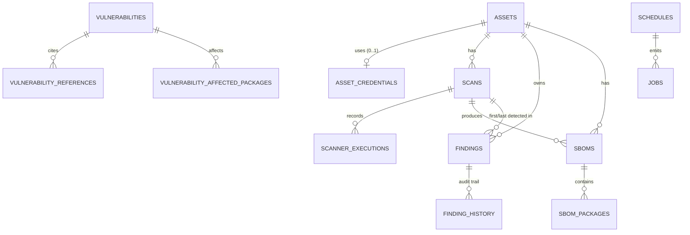

# Data model (ERD)

All primary keys are UUIDs generated in the application. Timestamps are
timezone-aware (`timestamptz`, session set to UTC). `created_at`/`updated_at`
exist on every table via a mixin.

## Table-by-table

### `asset_credentials`
Encrypted repository token. `encrypted_secret` is a Fernet token derived from
`ANS_CREDENTIAL_KEY`/`ANS_SECRET_KEY`; `secret_hint` is a masked suffix for UI
rendering only. Tokens are decrypted exclusively inside the worker when building
the clone request.

### `assets`
One row per repository. `repo_url` is unique and normalized (https, allow-listed
host). `provider` is `GITHUB`/`GITLAB`. `monitoring_enabled` +
`scan_interval_minutes` drive scheduling. `last_scan_at`/`last_scan_status` are a
denormalized convenience for list views; `scans` is the source of truth.

### `scans`
Lifecycle: `PENDING → RUNNING → COMPLETED|FAILED|CANCELED`. `trigger` is
`MANUAL`/`SCHEDULED`. Severity counters and `new_findings`/`resolved_findings`
are persisted for fast dashboards. A partial unique index
`(asset_id) WHERE status IN ('PENDING','RUNNING')` makes concurrent scans of the
same repository impossible at the database level.

### `scanner_executions`
One row per `(scan, scanner)` — enforced by a unique constraint. Stores status
(`SUCCESS`, `FAILED`, `TIMED_OUT`, `SKIPPED`), version, exit code, duration,
result count, the argv vector (no secrets), and truncated stdout/stderr excerpts
with token-shaped strings redacted.

### `findings`
The consolidated model. Key columns: `scanner`, `rule_id`, `category`,
`severity`, `file_path`/`line_number`, `package_name`/`package_version`/`purl`,
`cve_id`, `cvss_score`, `status`, `fingerprint`, `metadata` (JSONB),
`first_detected_at`, `last_detected_at`, `resolved_at`.

Constraints/indexes:
* `UNIQUE (asset_id, fingerprint)` — deduplication.
* CHECK constraints on `status` and `severity`.
* Indexes on `(asset_id,status)`, `severity`, `scanner`, `cve_id`,
  `last_detected_at` for the filtered list queries.

`first_scan_id`/`last_scan_id` reference `scans` with `ON DELETE SET NULL` so
scan retention pruning never deletes findings.

### `finding_history`
Append-only audit trail: `event` (`DETECTED`, `REDETECTED`, `REOPENED`,
`STATUS_CHANGED`, `AUTO_RESOLVED`, `ENRICHED`), `from_status`/`to_status`,
`actor` (`system`, `scanner`, API principal), optional `note` and `scan_id`.

### `sboms`
Metadata only: format, spec version, tool + version, `storage_key`, `sha256`,
`size_bytes`, `package_count`, `asset_id`, `scan_id`. The document lives in
object storage behind `StorageBackend`; the database never stores the JSON.

### `sbom_packages`
Extracted inventory: `name`, `version`, `ecosystem`, `purl`, `license`,
`source_type`, `cpe`. Indexed on `(name, version)` and `(ecosystem, name)` for
correlation and package search. Duplicate components are collapsed per SBOM.

### `vulnerabilities`
Normalized intelligence keyed by `UNIQUE (source, source_id)`:
`source` ∈ {`OSV`, `NVD`, `CISA_KEV`}; `cve_id` and `osv_id` nullable;
`cvss_score` numeric(3,1) nullable; `severity`; `published_at`/`modified_at`;
`is_kev`, `kev_due_date`, `kev_required_action`; `source_payload_hash` used to
skip no-op updates.

### `vulnerability_references`
`(vulnerability_id, url)` unique; `ref_type` keeps advisory tags/CWE notes.

### `vulnerability_affected_packages`
Per-vulnerability package impact: `ecosystem`, `package_name`, `purl`,
`affected_versions` (JSONB list), `fixed_versions` (JSONB list),
`version_ranges` (JSONB, raw range events). Indexed on `(ecosystem, name)` for
matching.

### `vulnerability_sync_history`
One row per sync attempt: source, status, start/finish, duration, processed/
created/updated counts, cursor (window start), error. `SUCCESS`/`PARTIAL` rows
define the next incremental window.

### `schedules`
`name` unique, `kind` ∈ {`SCAN`, `SYNC_OSV`, `SYNC_NVD`, `SYNC_KEV`}, JSONB
`payload`, `interval_seconds`, `enabled`, `last_run_at`, `next_run_at`,
`last_status`, `last_error`, `last_job_id`. Indexed on `(enabled, next_run_at)`.

### `jobs`
Queue + history: `kind`, JSONB `payload`, `status` (`QUEUED`, `RUNNING`,
`SUCCEEDED`, `FAILED`, `CANCELED`), `priority`, `attempts`/`max_attempts`,
`run_after`, `locked_at`, `locked_by`, `heartbeat_at`, `last_error`,
`schedule_id`. Indexed on `(status, run_after)` for claims.

## Relationship notes

* Deleting an asset cascades to its scans, findings, SBOMs and derived package
  rows; the credential row is removed by the service and `credential_id` is
  `ON DELETE SET NULL` so an orphaned credential can never be reused silently.
* `findings.cve_id` intentionally has **no** foreign key to `vulnerabilities`:
  a scanner can report a CVE that no feed has ingested yet, and a single CVE may
  exist in several sources. Correlation happens by value at query time.
* SBOM packages are not deduplicated across SBOMs: history matters (a package
  upgrade should be visible), so each SBOM owns its inventory.
* `jobs` and `schedules` are operational tables; they are safe to prune
  independently of security data.
